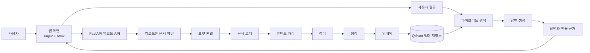
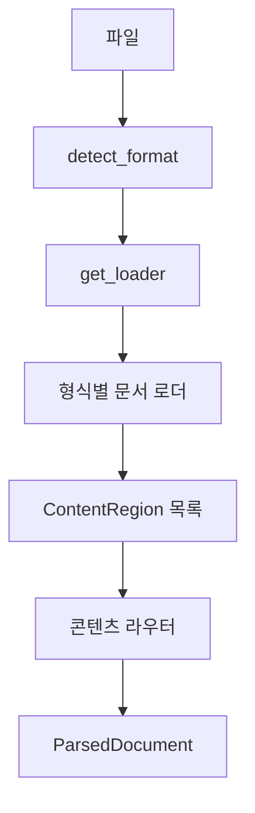
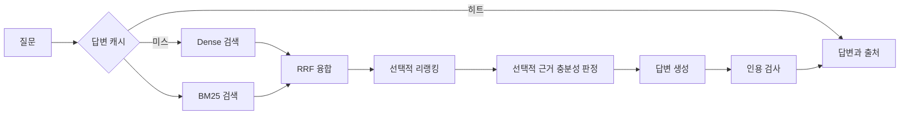

# 시스템 아키텍처

이 문서는 한국어 문서를 읽어 검색 가능한 형태로 저장하고, 근거와 함께 답변을 생성하는
Agentic RAG 시스템의 구성과 데이터 흐름을 설명합니다. 구현 규칙이나 작업 지침 대신,
서비스를 구성하는 모듈과 각 단계의 역할에 초점을 맞춥니다.

## 한눈에 보기

시스템은 크게 **문서 적재**, **검색·답변 생성**, **웹 애플리케이션** 세 부분으로 구성됩니다.



| 영역 | 주요 역할 | 대표 경로 |
|---|---|---|
| 적재 | 여러 문서 형식을 통일된 문서 구조로 변환하고 색인 | `rag_pipeline/ingestion/` |
| 검색·생성 | 관련 청크를 찾고 근거 기반 답변 생성 | `rag_pipeline/retrieval/`, `rag_pipeline/generation/` |
| 에이전트 | 근거가 부족할 때 검색·재작성·생성을 반복하는 선택 경로 | `rag_pipeline/agent/` |
| 웹 애플리케이션 | 업로드, 색인, 질의와 화면 렌더링 | `backend/` |

## 핵심 진입점

파이프라인은 HTTP나 화면에 의존하지 않는 세 개의 함수로 사용할 수 있습니다. 따라서
웹 서버뿐 아니라 스크립트, 노트북, 평가 도구에서도 같은 흐름을 재사용할 수 있습니다.

| 함수 | 입력 | 결과 | 역할 |
|---|---|---|---|
| `ingest()` | 파일 경로 | `ParsedDocument` | 문서를 읽고 정리된 요소 목록으로 변환 |
| `index_document()` | 파일 경로 | `IndexResult` | 파싱한 문서를 청킹·임베딩해 벡터 저장소에 저장 |
| `answer_question()` | 질문과 검색 의존성 | `Answer` | 검색 결과를 바탕으로 답변과 출처를 생성 |

재시도형 질의가 필요한 경우에는 `answer_question_with_retries()`가 에이전트 루프를 사용합니다.

관련 구현: [적재 진입점](rag_pipeline/ingestion/pipeline.py),
[질의 진입점](rag_pipeline/query.py)

## 문서 적재 흐름

### 1. 실제 파일 형식 판별

업로드 파일의 확장자만 믿지 않고 파일의 매직 바이트와 내부 구조를 확인합니다. ZIP 기반
형식은 내부 파일을 추가로 살펴 DOCX, PPTX, XLSX, HWPX 등을 구분합니다. 지원 대상에는
PDF, DOCX, PPTX, XLSX, HWPX, HWP, 이미지, 텍스트, CSV, Markdown이 포함됩니다.

### 2. 문서 구조 추출

형식별 문서 로더는 텍스트, 표, 이미지처럼 문서 안에 무엇이 어느 위치에 있는지를
`ContentRegion`으로 추출합니다. 로더의 출력은 이후 단계에서 공통으로 다룰 수 있는
`ParsedDocument`입니다.



### 3. 콘텐츠별 텍스트화

콘텐츠 라우터는 추출된 영역의 종류에 맞춰 처리기를 선택합니다.

| 콘텐츠 | 일반 처리 | 보조 처리 |
|---|---|---|
| 본문 | 원본 텍스트 추출 | 해당 없음 |
| 표 | PDF·문서 포맷의 기본 표 추출 | LlamaParse 또는 Vision 기반 보완 |
| 이미지 | 크기와 텍스트 유무 분류 | OCR 또는 Vision |

외부 API를 이용하는 처리기는 사용할 수 없는 상태이거나 처리에 실패해도, 가능한 기본
처리 결과를 남기는 방식으로 동작합니다. 따라서 표나 이미지 보조 처리가 실패하더라도
문서 전체 적재가 중단되지 않도록 설계되어 있습니다.

관련 구현: [형식 판별](rag_pipeline/ingestion/loader/detect.py),
[로더 등록](rag_pipeline/ingestion/loader/registry.py),
[문서 로더 기반 클래스](rag_pipeline/ingestion/loader/document/base.py),
[콘텐츠 라우터](rag_pipeline/ingestion/loader/content/router.py)

### 4. 정리, 청킹, 임베딩, 색인

문서 구조를 얻은 뒤에는 검색에 적합한 단위로 변환합니다.

1. **정리**: 공백, 제어 문자, 반복 머리말 등 문서 품질을 낮추는 요소를 정돈합니다.
2. **청킹**: 제목과 표의 구조를 가능한 한 보존하면서 검색 단위인 `Chunk` 목록을 만듭니다.
3. **임베딩**: 각 청크 텍스트를 벡터로 변환합니다. 기본 구성은 로컬 KURE-v1 임베더입니다.
4. **색인**: 청크와 벡터를 Qdrant에 저장합니다.

같은 파일을 다시 색인하면 이전 청크를 먼저 제거한 뒤 새 청크를 저장합니다. 이 방식은
수정된 문서에서 사라진 내용이 검색 결과에 남는 문제를 방지합니다.

관련 구현: [cleaner](rag_pipeline/ingestion/cleaner/),
[splitter](rag_pipeline/ingestion/splitter/),
[embedding](rag_pipeline/ingestion/embedding/),
[indexing](rag_pipeline/ingestion/indexing/)

## 검색과 답변 생성

질의 경로는 저장소에서 관련 청크를 검색하고, 그 청크를 근거로 답변을 만듭니다.



### 검색

기본 검색은 벡터 유사도를 이용하는 Dense 검색입니다. BM25 인덱스를 함께 제공하면
키워드 검색 결과와 Dense 검색 결과를 RRF(Reciprocal Rank Fusion) 방식으로 합칩니다.
필요에 따라 검색 결과를 리랭커로 다시 정렬하거나, 질의를 재작성해 검색 후보를 넓힐 수
있습니다.

### 답변 생성과 검증 정보

검색된 청크는 생성 모델에 전달되며, 반환되는 `Answer`에는 다음 정보가 담깁니다.

| 정보 | 설명 |
|---|---|
| 답변 텍스트 | 질문에 대한 생성 결과 |
| 출처 청크 | 답변 생성에 사용한 문서 조각 |
| 인용 검사 결과 | 인용 번호가 제공된 출처 범위에 맞는지 확인한 결과 |
| 충분성 판정 | 선택적으로 수행하는 근거 충분/불충분/실패 상태 |
| 재작성·재시도 흔적 | 선택 기능이 실행된 경우의 처리 기록 |

충분성 판정은 기본 질의 경로에서 답변 생성을 차단하지 않고, 근거 상태를 함께 보여 주는
관측 정보로 사용됩니다. 재시도형 진입점에서는 이 판정을 바탕으로 검색과 생성을 반복할 수
있습니다.

관련 구현: [하이브리드 검색](rag_pipeline/retrieval/hybrid.py),
[질의 재작성](rag_pipeline/retrieval/rewrite.py),
[답변 생성](rag_pipeline/generation/answer.py),
[에이전트 루프](rag_pipeline/agent/loop.py)

## 웹 애플리케이션

웹 계층은 FastAPI로 구성되어 있으며, 화면은 서버에서 Jinja2 템플릿으로 렌더링합니다.
htmx는 전체 페이지를 다시 로드하지 않고 문서 목록, 답변, 상태 영역 같은 화면 일부를
갱신하는 데 사용합니다.

| 구성 요소 | 역할 |
|---|---|
| `routes/documents.py` | 파일 업로드, 색인, 원본 파일 관리 |
| `routes/query.py` | 질의 처리와 HTMX용 HTML 조각 제공 |
| `routes/pages.py` | 기본 화면 렌더링 |
| `core/singletons.py` | 장시간 유지해야 하는 저장소·임베더 등의 인스턴스 관리 |
| `main.py` | 애플리케이션 초기화와 예외 응답 매핑 |

문서 로딩은 CPU 작업이므로 웹 요청을 막지 않도록 스레드풀에서 실행됩니다. 파이프라인에서
발생한 도메인 예외는 웹 계층에서 적절한 HTTP 상태 코드와 사용자 메시지로 변환됩니다.

## 설정과 외부 서비스

설정은 프로젝트 루트의 `.env`를 통해 읽습니다. 파싱·적재 설정은
`rag_pipeline/config.py`, 웹 애플리케이션 설정은 `backend/app/core/config.py`에서 관리합니다.

| 구성 | 기본 또는 주요 선택지 |
|---|---|
| 벡터 저장소 | Qdrant |
| 임베딩 | 로컬 KURE-v1 또는 OpenAI 임베딩 |
| 표 처리 | 기본 추출, LlamaParse, Vision 보완 |
| 이미지 처리 | OCR 또는 OpenAI Vision |
| 리랭킹 | 로컬 Cross-Encoder, OpenAI, Cohere |
| 답변 캐시 | 정확 일치 또는 의미 유사도 기반 |

외부 API 키가 없어도 기본적인 로컬 처리와 테스트가 가능하도록 구성되어 있으며, 외부 서비스는
기능을 확장하는 선택 항목으로 제공됩니다.

## 디렉터리 안내

```text
rag_pipeline/
├── ingestion/       문서 로딩, 정리, 청킹, 임베딩, 색인
├── retrieval/       Dense·BM25 검색, 융합, 재정렬, 질의 재작성
├── generation/      답변 생성, 인용 검사, 근거 충분성 판정
├── agent/           재시도형 검색·생성 루프
├── answer_cache/    답변 캐시
└── schemas/         문서, 청크, 검색, 답변의 공통 데이터 모델

backend/
└── app/             FastAPI 라우트, 템플릿, 정적 자산, 웹 설정

evaluation/          정답 질의 세트와 검색 품질 평가
tests/               단위 테스트와 통합 테스트
```

## 함께 보면 좋은 문서

- [프로젝트 소개와 실행 방법](README.md)
- [평가](evaluation.md)
