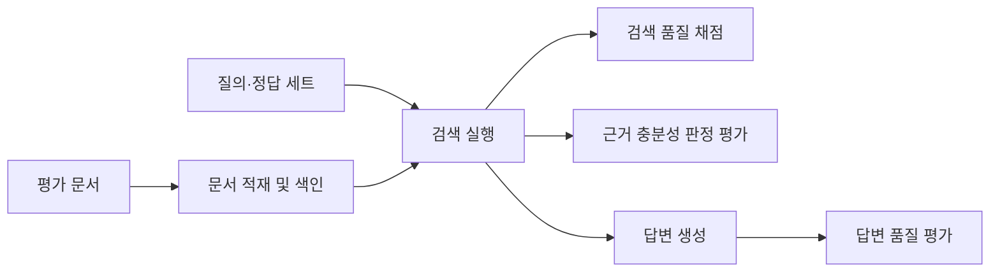
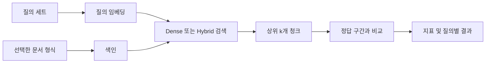
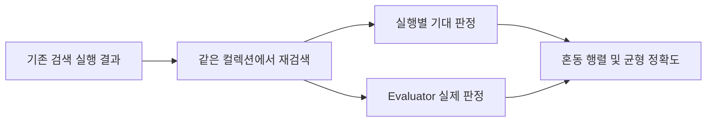

# 평가 체계

이 문서는 Agentic RAG 시스템의 검색, 근거 충분성 판정, 답변 품질을 어떻게 측정하는지
설명합니다. 평가는 단일 점수로 시스템 전체를 판단하지 않고, **검색 결과가 맞는지**,
**판정기가 그 근거를 올바르게 읽는지**, **생성된 답변이 근거에 충실한지**를 분리합니다.

## 한눈에 보기



| 평가 대상 | 확인하는 질문 | 주요 도구 |
|---|---|---|
| 검색 | 정답 근거를 상위 결과에서 찾았는가 | `evaluation.run_eval` |
| 충분성 판정 | 검색된 근거가 충분한지 올바르게 판정했는가 | `evaluation.verdicts` |
| 답변 품질 | 답변이 출처를 올바르게 인용하고 근거를 벗어나지 않는가 | `evaluation.answer_eval` |
| 재시도·재작성 | 다시 찾는 과정이 검색 결과를 개선하는가 | `evaluation.retry_diff` |

## 평가 데이터

### 질의와 정답 근거

기본 검색 평가 세트는 `evaluation/qa_set.jsonl`입니다. 한 줄이 하나의 질의를 나타내며,
질문, 대상 문서 그룹, 정답 문장 조각, 답변 가능 여부 등의 정보를 가집니다.

```json
{
  "query_id": "example-01",
  "query": "질문 내용",
  "source_doc": "문서-그룹",
  "gold_spans": ["문서 안에서 찾아야 하는 정답 문장"],
  "answerable": true
}
```

정답은 특정 청크 ID가 아니라 `gold_spans`라는 **문자열 구간**으로 관리합니다. 청킹 규칙이
바뀌어도 같은 문장 조각을 계속 정답으로 사용할 수 있어, 청킹 전후나 서로 다른 파일 형식을
공정하게 비교할 수 있습니다.

### 문서 그룹과 파일 형식

같은 문서의 PDF와 HWPX처럼 여러 형식이 있을 때, 파일명 대신 문서 그룹과 포맷 라벨로
대상을 구분합니다. 같은 질의를 각 형식에 적용하면 형식 차이가 검색 결과에 주는 영향을
확인할 수 있습니다.

평가에 쓰는 실제 파일은 `tests/fixtures/` 아래에 둘 수 있습니다. 원본 파일이 없는 환경에서는
파일 내용을 확인하는 검증 일부가 건너뛰어지므로, 질의·정답 레코드 자체의 형식 검증과 실제
문서 기반 검증은 구분해서 해석해야 합니다.

관련 구현: [질의 세트](evaluation/qa_set.py),
[문서 그룹](evaluation/documents.py), [평가 코퍼스](evaluation/corpus.py)

## 검색 품질 평가

검색 평가는 질의별로 상위 k개 청크를 가져와, 그 안에서 정답 문장 조각을 발견했는지
확인합니다.



### 측정 지표

| 지표 | 의미 | 주로 보는 상황 |
|---|---|---|
| `hit@k` | 상위 k개에 정답을 하나라도 찾았는지 | 검색 후보군의 도달 여부 |
| `recall@k` | 전체 정답 구간 중 찾은 비율 | 여러 근거를 가진 질문의 포괄성 |
| `MRR` | 첫 정답이 얼마나 앞 순위에 왔는지 | 전반적인 순위 품질 |
| `nDCG@k` | 상위 결과의 관련도 순서 품질 | 리랭커 효과 |
| `precision@k` | 상위 결과 중 정답을 포함한 비율 | 결과 목록의 밀도 |

정답 청크 수가 아니라 정답 문자열 구간을 기준으로 계산하므로, 문서 형식이나 청킹 크기가
달라도 `recall`의 분모가 달라지지 않습니다. 텍스트 비교에서는 PDF 추출 결과에 생길 수 있는
띄어쓰기 차이를 줄이기 위해 유니코드 정규화와 공백 제거를 적용합니다.

### 검색 실행

```powershell
# 질의 세트와 정답 구간의 유효성만 검사 — 외부 API 호출 없음
.\.venv\Scripts\python.exe -m evaluation.run_eval --check

# 평가용 파싱 캐시를 갱신하며 검사
.\.venv\Scripts\python.exe -m evaluation.run_eval --check --refresh

# PDF 형식으로 Dense 검색을 실행
.\.venv\Scripts\python.exe -m evaluation.run_eval --dense --format pdf --label dense-test

# Dense 검색과 BM25를 RRF로 결합한 Hybrid 검색 실행
.\.venv\Scripts\python.exe -m evaluation.run_eval --dense --hybrid --format pdf --label hybrid-test
```

`--dense`는 선택한 임베딩 프로필에 따라 외부 임베딩 API 비용이 발생할 수 있습니다.
`--check`는 파싱과 세트 검증만 수행합니다. 실행 결과는 기본적으로
`.cache/evaluation/runs/`에 JSON으로 저장되며, `--save-baseline`을 명시한 경우에만
`evaluation/baseline.json`이 갱신됩니다.

### k값을 나누어 보는 이유

한 번의 검색으로 넉넉한 수의 후보를 가져온 뒤, `1`, `3`, `5`, `10`, `20`처럼 여러 k에서
점수를 계산합니다. 작은 k는 사용자가 바로 보는 상위 결과의 품질을, 큰 k는 검색 후보군이
가진 잠재적인 도달 범위를 보여 줍니다.

관련 구현: [검색 평가 실행기](evaluation/run_eval.py),
[채점 지표](evaluation/scoring.py)

## 기준선과 비교 실험

기준선은 특정 평가 설정에서 얻은 결과를 보관한 비교 대상입니다. 새 실행은 기준선과의
질의별 변화도 함께 확인할 수 있습니다.

| 비교 축 | 예시 |
|---|---|
| 문서 형식 | PDF와 HWPX |
| 검색 방식 | Dense 검색과 Dense + BM25 Hybrid 검색 |
| 임베딩 | OpenAI 임베딩과 로컬 KURE-v1 |
| 리랭킹 | 미사용, 로컬 Cross-Encoder, 외부 리랭커 |
| 질의 재작성 | 미사용과 재작성 사용 |

비교할 때는 한 번에 하나의 축을 바꾸는 것이 좋습니다. 예를 들어 포맷을 비교할 때는 같은
문서 그룹·같은 임베더·같은 검색 설정을 유지해야 파일 형식 외의 영향을 줄일 수 있습니다.

평가 설정은 개발 머신의 일반 `.env` 값과 분리된 프로필을 사용합니다. 이로써 같은 프로필과
명령은 가능한 한 같은 조건에서 재실행할 수 있습니다.

관련 구현: [평가 프로필](evaluation/config.py),
[기준선 비교](evaluation/run_eval.py)

## 근거 충분성 판정 평가

근거 충분성 판정(Evaluator)은 검색된 청크만 보고 답변에 필요한 근거가 충분한지
`sufficient`, `insufficient`, `failed` 상태로 판단합니다. 검색 순위와 판정 품질은 서로
다른 문제이므로 별도로 측정합니다.



답이 존재하는 질의라도 해당 실행에서 정답 근거를 검색하지 못했다면 기대 판정은
`insufficient`입니다. 반대로, 답이 없는 부정 예시는 항상 `insufficient`가 기대값입니다.
이 방식은 Evaluator 자체가 아니라 검색 실패를 Evaluator의 오답으로 세는 일을 막아 줍니다.

평가 보고서는 전체 정확도뿐 아니라 충분·불충분 양쪽을 균형 있게 맞추는지와 `failed` 상태를
따로 보여 줍니다. 한쪽 답만 반복하는 판정기가 높은 점수를 받는 상황을 드러내기 위해서입니다.

관련 구현: [판정 평가](evaluation/verdicts.py)

## 답변 품질 평가

답변 평가는 검색 순위나 Evaluator 판정만으로 알 수 없는 생성 결과 자체를 다룹니다.
사람 검수용 질의 세트(`evaluation/qa_set_human.jsonl`)를 바탕으로 다음 항목을 확인합니다.

| 항목 | 확인 내용 | 비용 |
|---|---|---|
| 인용 정합성 | 인용한 출처 청크가 기대 근거를 포함하는지 | 없음 |
| 근거 지지 | 답변 문장이 제공된 근거로 뒷받침되는지 | LLM 판정 사용 시 발생 |
| 음성 대조군 | 다른 문서의 근거를 줬을 때 부정확한 지지를 하지 않는지 | LLM 판정 사용 시 발생 |
| 필수 사실 | 답변에 포함되어야 할 값이나 사실이 있는지 | 없음 |
| 단정 금지 | 근거 없는 단정을 했을 가능성이 있는지 | 사람 검토용 후보 목록 |

답변이 “근거를 찾지 못했습니다”처럼 기권하는 경우는 근거 지지 판정의 실패로 바로 처리하지
않고 별도 기권 지표로 확인합니다. 답변 품질 평가는 생성 모델 호출을 포함할 수 있으며,
LLM 판정 기능은 기본적으로 꺼져 있습니다.

관련 구현: [답변 평가](evaluation/answer_eval.py),
[답변 비교](evaluation/answer_diff.py)

## 결과를 읽는 순서

평가 결과가 예상과 다를 때는 다음 순서로 보면 원인을 좁히기 쉽습니다.

1. **적재 정보** — 문서별 청크 수, OCR·Vision 호출 수, 경고를 먼저 확인합니다.
2. **검색 지표** — `hit@k`와 `recall@k`로 정답 근거가 후보에 들어왔는지 봅니다.
3. **순위 지표** — `MRR`, `nDCG`, `precision`으로 상위 노출 품질을 확인합니다.
4. **질의별 결과** — 평균 점수에 가려진 특정 문서·질의의 변화를 확인합니다.
5. **판정·답변 평가** — 검색 결과가 확보된 뒤 Evaluator와 생성 품질을 따로 해석합니다.

## 디렉터리 안내

```text
evaluation/
├── qa_set.jsonl          검색 품질 평가 질의 세트
├── qa_set_human.jsonl    사람 검수 기반 답변 평가 질의 세트
├── documents.py          문서 그룹과 포맷 라벨 정의
├── corpus.py             문서 파싱·청크 기반 평가 코퍼스
├── run_eval.py           검색 평가 실행기
├── scoring.py            검색 지표 계산
├── verdicts.py           충분성 판정 평가
├── answer_eval.py        답변 품질 평가
├── retry_diff.py         재시도형 검색 흐름 비교
└── baseline.json         저장소에 보관하는 검색 기준선
```

## 함께 보면 좋은 문서

- [프로젝트 소개와 실행 방법](README.md)
- [시스템 구성](ARCHITECTURE.md)
