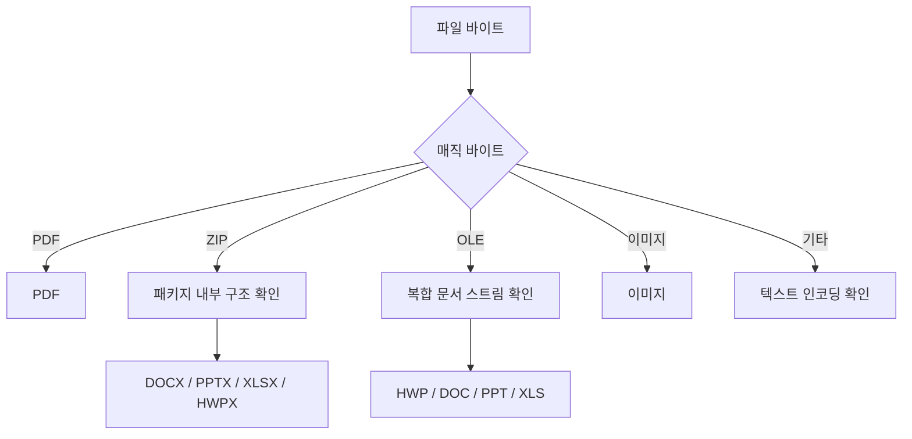
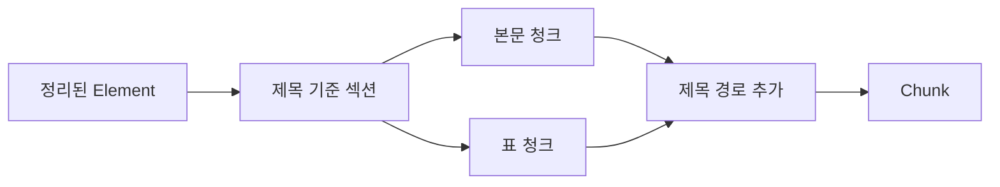

# 문서 적재 파이프라인

이 문서는 다양한 한국어 문서를 검색 가능한 벡터 데이터로 바꾸는 적재 파이프라인을
설명합니다. 파일 형식을 판별하고, 문서 구조와 표·이미지를 텍스트로 변환한 뒤,
정리·청킹·임베딩·색인을 거쳐 Qdrant에 저장합니다.

## 한눈에 보기


| 단계 | 입력 | 출력 | 역할 |
|---|---|---|---|
| 포맷 판별 | 파일 | `FileFormat` | 확장자 대신 실제 파일 구조 확인 |
| 문서 로딩 | 파일 | `ContentRegion` 목록 | 본문·표·이미지가 있는 위치 추출 |
| 콘텐츠 처리 | `ContentRegion` | `Element` 목록 | 콘텐츠 종류별로 텍스트화 |
| 정리 | `ParsedDocument` | `ParsedDocument` | 제어 문자, 공백, 반복 머리말 정리 |
| 청킹 | `ParsedDocument` | `Chunk` 목록 | 검색에 적합한 문서 조각 생성 |
| 임베딩 | 청크 텍스트 | 벡터 목록 | 텍스트 의미를 숫자 벡터로 변환 |
| 색인 | 청크와 벡터 | 저장 결과 | Qdrant에 저장해 검색 가능하게 만듦 |

## 두 가지 사용 방식

적재 파이프라인은 웹 서버와 분리되어 있어 스크립트, 노트북, FastAPI 모두에서 같은 함수를
사용할 수 있습니다.

| 함수 | 수행 범위 | 반환값 |
|---|---|---|
| `ingest()` | 포맷 판별 → 로딩 → 콘텐츠 처리 → 정리 | `ParsedDocument` |
| `index_document()` | `ingest()` → 청킹 → 임베딩 → Qdrant 저장 | `IndexResult` |

`ingest()`는 문서의 구조화된 파싱 결과가 필요한 경우에 쓰고, `index_document()`는 검색할 수
있도록 끝까지 저장해야 할 때 씁니다. 색인 결과에는 청크 수, 저장 수, 임베딩 사용량과 OCR·Vision
호출 횟수 같은 적재 메타데이터가 함께 포함됩니다.

관련 구현: [파이프라인 진입점](rag_pipeline/ingestion/pipeline.py)

## 지원하는 입력 형식

| 구분 | 형식 |
|---|---|
| 문서 | PDF, DOCX, PPTX, HWPX |
| 스프레드시트 | XLSX, XLS |
| 이미지 | PNG, JPEG, GIF, BMP, TIFF, WebP |
| 텍스트 | TXT, Markdown, CSV, TSV |
| 인식 후 안내 | HWP, DOC, PPT |

HWP, DOC, PPT 같은 구형 바이너리 형식은 실제 형식으로 인식하지만 현재 파싱 경로는 제공하지
않으므로 명확한 형식 안내와 함께 거부합니다.

### 확장자보다 실제 구조를 먼저 보는 이유

DOCX·PPTX·XLSX·HWPX는 모두 ZIP 컨테이너이고, 여러 구형 오피스 형식은 모두 OLE 복합
문서입니다. 따라서 파일 확장자만으로는 형식을 안전하게 구분할 수 없습니다.

파이프라인은 매직 바이트를 먼저 확인하고, ZIP·OLE 파일은 내부 파일과 스트림 이름까지
확인합니다. 텍스트 계열 파일만 보조적으로 파일 확장자를 사용합니다.



관련 구현: [포맷 판별](rag_pipeline/ingestion/loader/detect.py),
[로더 등록](rag_pipeline/ingestion/loader/registry.py)

## 문서 로딩과 콘텐츠 처리

### 문서 로더의 역할

형식별 로더는 문서 안에서 **무엇이 어디에 있는지**를 추출합니다. 예를 들어 PDF 로더는
본문 블록, 표, 이미지 영역을 찾고, HWPX 로더는 XML 구조에서 문단·표·이미지를 읽습니다.
이 단계의 결과는 공통 구조인 `ContentRegion` 목록입니다.

모든 형식별 로더는 공통 기반 클래스의 처리 흐름을 따릅니다.


`ParsedDocument`에는 요소뿐 아니라 원본 파일명, 페이지 수, 파싱 시간, OCR·Vision·표 파서
호출 수, 경고가 함께 저장됩니다. 이 정보는 이후 검색 결과 변화가 파싱 변화에서 왔는지
판별할 때도 사용됩니다.

관련 구현: [공통 문서 로더](rag_pipeline/ingestion/loader/document/base.py),
[문서 스키마](rag_pipeline/schemas/document.py)

### 콘텐츠별 처리 경로

콘텐츠 라우터는 로더가 찾아낸 영역의 종류에 맞는 텍스트 처리기를 선택합니다.

| 콘텐츠 | 기본 처리 | 선택적 보완 | 실패 시 결과 |
|---|---|---|---|
| 일반 텍스트 | 원본 텍스트 사용 | 없음 | 텍스트 요소 생성 |
| 표 | 로컬 표 추출 | LlamaParse 또는 Vision 보완 | 로컬 표 결과 사용 |
| 이미지 | OCR 또는 건너뜀 | Vision | OCR 결과 또는 빈 결과 |

표와 이미지의 외부 API 처리는 정확도를 높이기 위한 보조 경로입니다. 호출할 수 없거나 결과가
없어도 로컬 처리 결과를 사용할 수 있도록 구성되어, 특정 외부 서비스의 장애가 문서 전체
적재 실패로 이어지지 않습니다.

#### 표 처리

표는 가능한 경우 원래의 행·열 구조를 유지해 Markdown과 2차원 행 데이터로 만듭니다. 행 데이터가
있는 표는 청킹할 때 헤더 행을 반복해 각 조각이 독립적으로 읽히도록 합니다. PDF 표에서 비어
있는 칸에 벡터 표시가 있는 경우에는 Vision 보완을 선택할 수 있으며, 이때도 표 전체를 다시
읽지 않고 비어 있는 셀만 채웁니다.

#### 이미지 처리

이미지는 작은 로고·아이콘·구분선 같은 장식 요소를 먼저 제외합니다. 남은 이미지는 OCR 결과의
글자 수와 신뢰도를 기준으로 글자 중심이면 OCR을 사용하고, 그림 중심이면 Vision으로 보낼 수
있습니다. Vision 처리가 실패하면 분류 단계에서 얻은 OCR 결과를 재사용합니다.

관련 구현: [콘텐츠 라우터](rag_pipeline/ingestion/loader/content/router.py),
[이미지 분류](rag_pipeline/ingestion/loader/content/classify.py),
[로컬 표 처리](rag_pipeline/ingestion/loader/content/table_native.py)

## 문서 정리와 청킹

### 텍스트 정리

정리 단계는 검색에 불필요한 노이즈를 줄이되, 문서의 원래 순서와 구조를 유지합니다.

- 제어 문자와 비정상 공백을 정리합니다.
- 여러 페이지에 반복되는 머리말을 찾아 제거할 수 있습니다.
- 표는 화면용 텍스트와 구조화된 행 데이터가 서로 다르게 남지 않도록 함께 정리합니다.
- 변경이 없는 요소는 재사용해 불필요한 복사를 줄입니다.

### 청킹

청킹은 단순히 일정 글자 수로 자르는 작업이 아니라 문서 구조를 보존하는 과정입니다.

1. 제목을 경계로 본문 요소를 섹션으로 묶습니다.
2. 제목 경로를 청크 앞에 붙여, 청크 하나만 검색되어도 어느 절의 내용인지 알 수 있게 합니다.
3. 본문은 설정한 최대 길이 안에서 요소 경계를 우선 보존합니다.
4. 표는 본문과 분리해 행 단위로 나누고, 필요한 경우 헤더 행을 각 조각에 반복합니다.
5. 지나치게 긴 텍스트만 글자 단위 분할과 겹침을 적용합니다.



관련 구현: [정리 단계](rag_pipeline/ingestion/cleaner/),
[청킹 단계](rag_pipeline/ingestion/splitter/)

## 임베딩과 벡터 색인

청크 본문은 임베더를 통해 고정 길이 벡터가 됩니다. 기본 구성은 로컬 KURE-v1이며, 설정에 따라
OpenAI 임베딩을 사용할 수도 있습니다. 임베딩 단계는 청크와 벡터의 개수·차원을 검사한 뒤,
같은 순서의 쌍만 저장 레코드로 만듭니다.

Qdrant에는 청크 텍스트, 벡터, 문서 ID, 청크 ID, 페이지·제목 같은 메타데이터를 함께 저장합니다.
문서 ID는 원본 파일명을 기준으로 만들며, 재색인할 때는 해당 문서의 기존 청크를 먼저 삭제한 뒤
새 레코드를 저장합니다. 따라서 문서에서 사라진 내용이 오래된 검색 결과에 남지 않습니다.


관련 구현: [임베딩](rag_pipeline/ingestion/embedding/),
[저장 레코드 조립](rag_pipeline/ingestion/indexing/records.py),
[Qdrant 저장소](rag_pipeline/ingestion/indexing/qdrant_store.py)

## 실측으로 본 병목과 해석

아래 수치는 특정 실파일과 측정 환경에서 얻은 결과입니다. 일반적인 보장값이 아니라, 적재
성능을 해석할 때 어느 단계를 먼저 의심해야 하는지 보여 주는 근거로 읽으면 됩니다.

| 대상과 조건 | 측정값 | 설명 |
|---|---:|---|
| 47쪽·13MB 스캔 PDF, OCR 워커 1 | 239.8초 | 스캔본은 OCR이 적재 시간의 대부분을 차지합니다. |
| 같은 파일, OCR 워커 8 | 51.8초 | 결과를 유지한 채 약 4.6배 빨라졌습니다. 기본 워커 수 8은 속도와 서버 CPU 점유의 균형점입니다. |
| 같은 파일, OCR 워커 16 | 42.3초 | 8개보다 더 빠르지만 추가 이득은 9.5초로 작습니다. 병렬화를 더 늘리기보다 직렬 구간을 살피는 편이 다음 개선 후보입니다. |
| KURE-v1로 25청크 첫 임베딩 | 23.629초 | 새 프로세스의 첫 색인은 모델 가중치 적재 시간이 크게 작용합니다. |
| 같은 조건의 두 번째 임베딩 | 0.164초 | 모델이 메모리에 올라온 뒤의 계산은 매우 짧아, 웹 앱에서 임베더를 재사용하는 이유가 됩니다. |

OCR 측정에서는 모든 워커 구성에서 요소 47개, 본문 45,514자, Vision 호출 0회가 동일했습니다.
즉 속도 개선이 일부 페이지를 건너뛰어서 생긴 결과가 아니라, 같은 산출물을 병렬로 처리해서
얻은 변화임을 함께 확인했습니다.

측정 근거: [OCR 병렬화 검증](.claude/wiki/verify_log/2026-08-24-ocr-병렬화.md),
[임베더 재사용 검증](.claude/wiki/verify_log/2026-08-27-임베더-싱글턴-주입.md)

## 실행과 확인

웹 서버를 실행하면 업로드·색인 API가 `index_document()`를 사용합니다. 파이프라인 자체는
Python 코드에서 직접 호출할 수도 있습니다.

```python
from rag_pipeline.ingestion.pipeline import ingest, index_document

# 파싱 결과만 필요할 때
document = ingest("문서.pdf")

# 검색 가능하도록 끝까지 색인할 때
result = index_document("문서.pdf")
```

기본 단위 테스트는 외부 API 키 없이 실행되도록 구성되어 있습니다.

```powershell
.\.venv\Scripts\python.exe -m pytest tests/ingestion
```

## 디렉터리 안내

```text
rag_pipeline/ingestion/
├── loader/
│   ├── detect.py          실제 파일 형식 판별
│   ├── registry.py        형식별 로더 선택
│   ├── document/          PDF·HWPX·Office·이미지·텍스트 로더
│   └── content/           텍스트·표·이미지 처리와 라우팅
├── cleaner/               문자·공백·반복 머리말 정리
├── splitter/              섹션·표 중심 청킹
├── embedding/             로컬·OpenAI 임베더
├── indexing/              레코드 조립과 Qdrant 저장
└── pipeline.py            ingest와 index_document 진입점
```

## 함께 보면 좋은 문서

- [프로젝트 소개와 실행 방법](README.md)
- [전체 시스템 구성](ARCHITECTURE.md)
- [검색·답변 평가 체계](EVALUATION.md)
