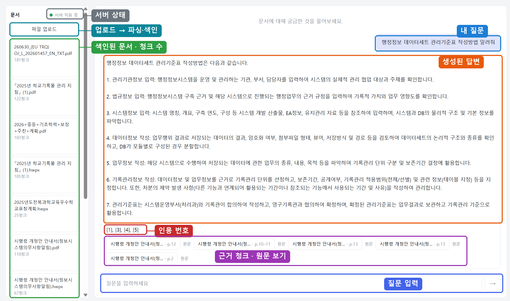
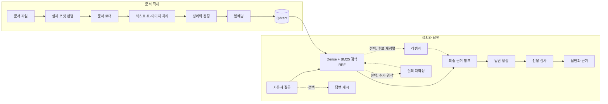
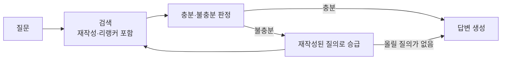

# Agentic RAG — 한국어 공공문서 검색·답변 시스템

**PDF·HWPX·Office 문서를 읽고, 검색 근거와 함께 답변하는 한국어 문서 RAG 시스템**


한국어 공공 문서는 일반 RAG 예제와 조건이 다릅니다.

- PDF·HWPX·Office 형식이 섞여 있고, 병합 셀 표와 쪽을 넘기는 표, 이미지 속 글자가 자주 나옵니다.
- 같은 내용이라도 어느 형식으로 읽었느냐에 따라 파싱 결과가 달라지고, 그것이 검색 품질까지 바꿉니다.
- 한국어는 임베딩 모델과 리랭커를 바꿀 때 결과 차이가 큽니다.

그래서 이 프로젝트는 문서를 벡터로 바꾸는 데서 끝내지 않고, 어떤 형식으로 읽었는지, 어떤 청크를 근거로 찾았는지, 검색 품질이 실제로 좋아졌는지 까지 확인할 수 있게
만들었습니다. 정답 질의 세트를 직접 만들어 모든 수치 결정을 그 세트로 내렸고, 기각한 방법과
되돌린 시도도 기록으로 남겼습니다.

<p>
  
</p>

## 주요 기능

- **다양한 입력 형식**: PDF, DOCX, HWPX, 
  (옛 한글 형식 `.hwp`는 감지만 하고, 변환 안내와 함께 거부합니다)
- **문서 구조 보존**: 텍스트·표·이미지를 공통 문서 구조로 바꾸고 제목·쪽 번호·출처를 유지
- **비용을 고려한 콘텐츠 처리**: 무료·로컬 OCR(Tesseract)을 먼저 돌리고, 필요한 표·이미지에만
  Vision 이나 외부 파서(LlamaParse)를 선택적으로 씁니다
- **하이브리드 검색**: Dense 검색과 BM25 검색을 RRF 로 결합
- **선택적 검색 개선**: 리랭커(로컬 Cross-Encoder · Cohere · OpenAI listwise)와 1차 검색 결과를
  재료로 쓰는 질의 재작성(PRF)
- **근거 중심 답변**: 검색 청크를 출처로 함께 내고, 답변이 쓴 인용 번호를 검사
- **측정 가능한 개선**: 정답 질의 세트와 기준선으로 검색·판정·답변 품질을 따로 평가

## 시스템 흐름

실선은 기본 경로이고, 점선은 구현돼 있지만 저장소 기본값에서는 꺼져 있는 단계입니다
(`.env` 로 켭니다).



### 1. 문서 적재

확장자를 믿지 않고 파일의 매직 바이트와 내부 구조를 확인해 실제 형식을 판별합니다. 형식별
로더는 문서에서 본문·표·이미지 영역이 어디에 무엇이 있는지만 답하고, 그것을 글자로 바꾸는
일은 콘텐츠 핸들러가 맡습니다. 이 경계 때문에 "표를 외부 파서로 볼지, 이미지를 Vision 으로
볼지" 를 로더를 건드리지 않고 설정으로 바꿀 수 있습니다.

표는 원래 행·열 구조를 살려 청킹하고, 이미지는 크기와 OCR 신뢰도를 보고 건너뜀·OCR·Vision
가운데 하나를 고릅니다. 외부 API 처리는 실패해도 예외를 던지지 않고 로컬 결과로 내려가므로,
키가 없거나 외부 서비스가 죽어도 문서 적재 자체는 끝까지 진행됩니다.

### 2. 검색과 답변

질문은 임베딩 기반 Dense 검색과 키워드 기반 BM25 검색으로 후보 청크를 찾습니다. 두 결과는
점수 범위가 서로 달라 직접 더하지 않고 RRF 로 순위를 결합합니다. 선택적으로 리랭커가 넓은
후보 풀의 순서를 다시 매기고, 질의 재작성기는 1차 검색 결과에서 그 문서가 쓰는 낱말을 참고해
질의를 넓혀 한 번 더 검색합니다.

생성 모델은 최종 청크만 근거로 답변을 만듭니다. 답변이 쓴 `[n]` 번호가 실제 근거 범위 안인지,
근거가 있는데 인용이 하나도 없는지를 인용 검사가 따로 확인합니다. 이 검사는 외부 모델을 부르지
않고 답변과 출처 목록만 읽습니다.

### 3. 재시도형 에이전트 경로 (선택)

판정으로 흐름을 가르는 쪽은 기본 경로와 분리된 별개 진입점입니다. 같은 인자를 받는 형제
함수이고, 한 함수의 스위치로 접지 않았습니다 — 기본 경로는 "판정이 답변을 안 바꾼다" 가
계약이고 이쪽은 "판정이 흐름을 가른다" 라, 합치면 한 함수가 반대되는 두 계약을 갖습니다.



루프는 질의를 새로 쓰지 않습니다. 재작성은 검색 단계 안에서 판정보다 먼저 이미
돌았고, 루프가 하는 일은 그 질의를 다음 회차의 질의로 올리는 것입니다. 그래서 재작성기가 꺼져
있으면 회차 수를 아무리 올려도 첫 재시도가 "올릴 질의가 없음" 으로 접힙니다. 회차 수가 스위치를
겸하고 `0` 이 곧 꺼짐이며, 구현은 LangGraph 를 선택 의존성으로 씁니다. 저장소 기본값은 꺼짐입니다.

## 실측 결과

### 적재 (무료 OCR 병렬화)

47쪽 전면 스캔 PDF(추출 가능한 텍스트 0자, 이미지 47개 전부 OCR)에서 측정했습니다.

| OCR 워커 | 적재 시간 |
|---|---:|
| 기준선(병렬화 전) | 237.5초 |
| 1 | 239.8초 |
| 8 | **51.8초** |
| 16 | 42.3초 |

- 워커 1 이 기준선과 같다는 것이 먼저입니다. 병렬화 골격 자체의 오버헤드가 사실상 0 이라,
  그 위의 배속을 믿을 바닥이 됩니다.
- 워커를 1·2·4·8·16 으로 바꾼 다섯 구성이 요소 수 47 · 본문 45,514자 · OCR 출처 47 · 외부 Vision 호출 0 을 모두 똑같이
  만족했습니다. 결과를 줄여서가 아니라 병렬 OCR 로 약 4.6배 줄인 것입니다.
- 워커 8은 한계가 아닙니다. 16이 18% 더 빠른 것은 사실이지만, 같은 서버가 질의도
  받으므로 코어를 다 물지 않는 쪽을 골랐습니다.
- 유료 경로(Vision·외부 파서)는 일부러 직렬로 남겼습니다. 호출 상한 검사와 증가가 갈라져 있어
  병렬로 올리면 상한을 넘겨 과금되는데, 키 없이 도는 기본 테스트가 그것을 못 잡습니다.


### 임베더와 리랭커

검색 품질은 공개 한국어 공문서 4종과 정답 질의 세트에서 측정했습니다. 원값은
[`verify_log`](.claude/wiki/verify_log/INDEX.md) 에 있습니다.

같은 하이브리드 검색(Dense + BM25) 조건에서 임베더와 리랭커만 바꾼 비교입니다(LLM 질의 60건).

| 구성 | hit@1 | MRR | hit@10 | hit@50 |
|---|---:|---:|---:|---:|
| OpenAI 임베딩, 리랭커 없음 | 0.2667 | 0.3875 | 0.6667 | 0.8833 |
| **KURE-v1**, 리랭커 없음 | 0.4333 | 0.5455 | 0.8167 | **0.9833** |
| KURE-v1 + 로컬 Cross-Encoder | **0.5833** | **0.6816** | **0.8667** | 0.9833 |

- 한국어 임베더로 바꾸면 정답이 후보에 들어오는 상한(`hit@50`)이 0.8833 에서 0.9833 으로 오릅니다.
- 리랭커는 그 상한을 올리지 않고 순서만 고칩니다. 두 구성의 `hit@50` 이 글자 그대로 같습니다.
  그래서 임베더와 리랭커는 대체재가 아니라 보완재입니다.
- 리랭커를 "후보 수 기준 recall" 로만 쟀다면 네 칸 모두 "효과 없음" 으로 보였을 것입니다.
  순서를 재는 지표(`hit@1`·MRR·nDCG)로 재야 보이는 효과입니다.

### 리랭커 셋 비교

| 리랭커 | nDCG@10 (자동 세트 60건) | hit@1 (사람 세트 18건) | hit@10 (사람 세트 18건) |
|---|---:|---:|---:|
| 없음 (RRF 순서) | 0.6156 | **0.4444** | 0.7222 |
| 로컬 Cross-Encoder | 0.7327 | 0.3889 | 0.8333 |
| Cohere Rerank | **0.7674** | 0.3333 | **0.8889** |

정답 질의 세트가 둘이고 만든 방식이 다릅니다. 자동 세트 60건은 LLM 이 질의와 정답 조각을
초안으로 만들고 사람이 전건 확인한 것, 사람 세트 43건은 사람이 문서를 읽고 직접 쓴 것입니다.
사람 세트 43건 중 검색 채점에 들어가는 것은 코퍼스에 답이 있는 18건이고, 나머지 25건은
"답이 없는 것이 정답"인 부정 예시라 빠집니다. 그 25건은 답변이 기권해야 할
자리에서 기권하는지를 재는 데 씁니다.

- 자동 세트 60건에서는 리랭커가 모든 칸에서 RRF 를 이기는데,
  사람 세트 18건에서는 RRF 가 머리(`hit@1`)를, 리랭커가 깊이(`hit@10`)를 가져갑니다.
  왜 그런지는 아직 갈라내지 못했습니다.
- 후보 원인 하나는 질의 어휘입니다. 자동 세트는 질의와 정답 조각을 문서 본문을 보고
  만들었고, 사람이 확인한 것은 "이 질문에 이 정답이 맞는가"이지 "실제 사용자의 말투인가"가
  아닙니다. 정답 조각이 원문 그대로라 어휘가 문서에 기울 수 있습니다.
- 사람 세트는 18건이라 질의 하나가 5.6%p 입니다. 머리 쪽 수치의 부호를 이 표본으로 단정하지
  않습니다. 한때 이 역전을 "정답 라벨이 좁아서" 로 설명했는데, 사람 세트 43건을 전수 검수한
  뒤에도 역전이 남았고 격차는 오히려 벌어졌습니다(`MRR@10` 0.0262 → 0.0795, RRF 쪽).

평가 방법과 전체 수치는 [EVALUATION.md](EVALUATION.md) 에 있습니다.

## Quick Start

Windows + Python 3.11 기준입니다.

```powershell
# 가상환경과 의존성 (torch·sentence-transformers 포함)
uv venv
uv pip install -r requirements.txt

# 환경 변수 템플릿 복사 (.env 는 git 에 올라가지 않습니다)
Copy-Item .env.example .env

# 개발 서버 실행
.\.venv\Scripts\python.exe -m uvicorn backend.app.main:app --reload
```

서버가 뜨면 `http://127.0.0.1:8000` 에서 문서를 올리고 질의할 수 있습니다.

- 기본 임베더는 로컬 KURE-v1 이라 임베딩 비용이 들지 않습니다. 대신 첫 색인 때 모델
  가중치 약 2.3GB 를 내려받습니다. GPU 로 돌리려면 PyTorch CUDA 환경을 따로 깔고 장치 설정을
  바꿔야 합니다.
- `OPENAI_API_KEY` 는 답변 생성과 이미지 Vision 에 씁니다.
- `LLAMA_CLOUD_API_KEY`(표 파싱) · `COHERE_API_KEY`(리랭커) · `TAVILY_API_KEY`(웹 검색) 는
  선택이고, 없으면 무료 경로로 동작합니다.
- 이미지 속 글자를 읽으려면 Tesseract 를 따로 설치해야 합니다(5.5.0 + 한국어 traineddata).
  PATH 에 없으면 `.env` 의 `TESSERACT_CMD` 로 지정합니다.

## 테스트와 평가

```powershell
# 기본 테스트 — API 키 없이 전부 통과해야 합니다 (외부 호출 테스트는 기본에서 제외)
.\.venv\Scripts\python.exe -m pytest

# 정답 세트가 성립하는지만 확인 — 과금 없음
.\.venv\Scripts\python.exe -m evaluation.run_eval --check

# Dense 검색 평가 — 임베딩 프로필에 따라 외부 API 비용이 들 수 있습니다
.\.venv\Scripts\python.exe -m evaluation.run_eval --dense --format pdf --label dense-test

# Dense + BM25 하이브리드 검색 평가
.\.venv\Scripts\python.exe -m evaluation.run_eval --dense --hybrid --format pdf --label hybrid-test
```

> **주의:** `pytest -m integration` 과 일부 평가 명령은 실제 외부 API 를 호출해 **과금됩니다.**
> 실제 한컴·PDF 회귀 테스트용 원본 파일은 저장소에 없고, 파일이 없으면 해당 테스트는 조용히
> 건너뜁니다.

## 프로젝트 구조

```text
rag_pipeline/
├── ingestion/       파일 판별, 로딩, OCR·표 처리, 정리, 청킹, 임베딩, 색인
├── retrieval/       Dense·BM25 검색, RRF, 리랭킹, 질의 재작성
├── generation/      답변 생성, 인용 검사, 근거 충분성 판정
├── agent/           재시도형 검색·생성 루프
├── answer_cache/    답변 캐시
└── schemas/         공통 데이터 모델

backend/             FastAPI + Jinja2 + htmx 기반 서버 렌더 화면과 API
evaluation/          정답 질의 세트, 평가 실행기, 지표
regression/          적재 결과의 기준선과 회귀 대조
tests/               단위·통합 테스트
```

## 참고 문서

| 문서 | 내용 |
|---|---|
| [ARCHITECTURE.md](ARCHITECTURE.md) | 전체 구성과 웹·파이프라인 경계 |
| [INGESTION.md](INGESTION.md) | 문서 적재, 표·이미지 처리, 청킹, 색인 |
| [RETRIEVAL.md](RETRIEVAL.md) | Dense·BM25·RRF·리랭킹·질의 재작성 |
| [EVALUATION.md](EVALUATION.md) | 검색·판정·답변 품질 평가와 기준선 |

성공한 코드는 저장소에 남지만 기각한 대안과 되돌린 시도는 안 남습니다. 그쪽 기록은 따로 있습니다.

- 설계 및 작업 로그 → [`plan_log`](.claude/wiki/plan_log/INDEX.md) · [`task_log`](.claude/wiki/task_log/INDEX.md)
- 결과값 기록 → [`verify_log`](.claude/wiki/verify_log/INDEX.md)
- LLM Wiki → [`knowledge`](.claude/wiki/knowledge/) 

## 데이터와 출처

평가에는 공개된 한국어 공문서 4종(시행령 개정안 안내서, 공공기관 신뢰가능 AI 구현 실용가이드,
중등 기초학력 보장 계획, 학교기록물 관리 지침)을 썼습니다. **원본 파일은 저장소에 포함하지
않았고**, 정답 세트에는 평가에 필요한 짧은 발췌만 들어 있습니다. 문서의 저작권은 각 발행
기관에 있습니다.
