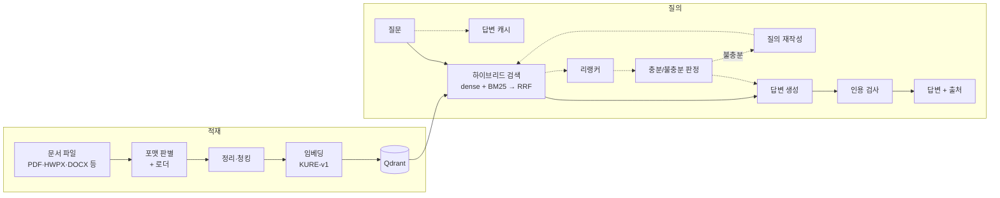

# Agentic-Rag

**한국어 공문서(HWPX · PDF 등)를 읽고, 근거를 인용해 답하는 Agentic RAG 시스템**

이 프로젝트는 단순히 RAG를 돌려 보는게 아니라 어떤 선택이 더 좋은지 검사해보고 정한것에 대한 근거를 보여주기 위해 만들었습니다.
정답 질의 세트를 직접 만들고, 모든 수치 결정을 그 세트로 내렸고, 기각한 방법과 실패도 기록으로 남겼습니다.


한국 공문서는 일반 RAG 예제와 다르게 다양한 문제가 존재합니다.

- HWPX · 한컴 · PDF가 섞여 있고, 표(병합 셀, 쪽을 넘기는 표)와 이미지 속 글자가 흔합니다.
- 같은 내용도 포맷에 따라 파싱 결과가 달라져 검색 품질이 달라질 수 있습니다.
- 한국어는 임베딩 모델과 리랭커에 따라 결과 차이가 큽니다.

그래서 문서를 올리면 믿고 검색할 수 있는 형태로 바꾸고 답변이 생성될 때 근거가 함께 나오는 과정을 직접 만들었습니다.

## 구조

실선은 기본 경로, 점선은 구현되어 있지만 저장소 기본값에서는 꺼져 있는 단계입니다(`.env`에서 설정할 수 있습니다).



- 적재 단계는 문서 로더가 "어디에 무엇이 있나"만 알고, 표·이미지를 글자로 바꾸는 일은 콘텐츠 핸들러가 맡도록 경계를 나눴습니다. 외부 API 핸들러는 실패해도 예외를 던지지 않고 폴백합니다.
- 질의 단계는 하이브리드 검색을 통해 답변을 생성하고 리랭커로 관련도 높은순으로 재정렬합니다. 질문에 대한 답변이 충분한지 결정을 내리고 만약 불충분하다고 판단되면 다시 검색을 돌립니다.
- 더 자세한 그림과 경계 규칙은 [`architecture.md`](.claude/wiki/overview/architecture.md)에 있습니다.

## 실측 결과

모두 실제 PDF 4개 문서를 통해 얻은 값입니다. 원값은 [`verify_log`](.claude/wiki/verify_log/)에 있습니다.

### 임베딩 모델과 리랭커

| 구성 (하이브리드: dense + BM25) | hit@1 | MRR | hit@10 | hit@50 |
|---|---:|---:|---:|---:|
| (디폴트)OpenAI 임베딩, 리랭커 없음 | 0.2667 | 0.3875 | 0.6667 | 0.8833 |
| **KURE-v1**, 리랭커 없음 | 0.4333 | 0.5455 | 0.8167 | **0.9833** |
| KURE-v1 + 로컬 리랭커 | **0.5833** | **0.6816** | **0.8667** | 0.9833 |

- 한국어 베이스 임베더로 바꾸면 후보에 정답이 들어오는 상한(hit@50)이 오릅니다. 0.8833 → 0.9833.
- 리랭커는 hit@50 값을 올리지않고 순서만 고칩니다. 두 구성의 hit@50이 글자 그대로 같습니다. 그래서 둘은 대체재가 아니라 보완재입니다.
- 리랭커를 "후보 수 기준 recall"로만 쟀다면 네 칸 모두 "효과 없음"으로 보였을 것입니다. 순서 지표(hit@1, MRR, nDCG)로 재야 보이는 효과입니다.

### 리랭커 비교

| 리랭커 | nDCG@10 (LLM 질의 60건) | hit@1 (사람 검수 18건) |
|---|---:|---:|
| 없음 | 0.6156 | **0.1667** |
| 로컬 (bge-reranker-v2-m3) | 0.7327 | 0.1111 |
| Cohere | **0.7674** | 0.1111 |

로컬 리랭커와 상용 리랭커를 비교해봤을 때 상용 리랭커가 약간의 더 좋은 성능을 보여줍니다. 사소한 차이이기 때문에 로컬로 돌리는게 더 합리적인 결정일 수 있지만 현 프로젝트를 진행하는 PC의 하드웨어 한계 때문에 상용 리랭커를 채택했습니다(VRAM 8기가). 임베더도 로컬로 돌리기 때문에 리랭커까지 그래픽카드에 적재되면 과부화가 걸리고 오히려 속도를 늦추는 현상이 발생하여 상용 리랭커를 채택했습니다.


## 실행하기

Windows + Python 3.11 기준입니다.

```powershell
# 1) 가상환경과 의존성 (torch · sentence-transformers 포함, 첫 색인 때 KURE-v1 가중치 약 2.3GB를 받습니다)
uv venv
uv pip install -r requirements.txt

# 2) 환경 변수: 템플릿을 복사해 키를 채웁니다 (.env 는 git에 올라가지 않습니다)
Copy-Item .env.example .env

# 3) 서버 실행 → http://127.0.0.1:8000
.\.venv\Scripts\python.exe -m uvicorn backend.app.main:app --reload
```

- `OPENAI_API_KEY`는 답변 생성과 이미지 Vision에 쓰입니다. `LLAMA_CLOUD_API_KEY`(표 파싱), `COHERE_API_KEY`(리랭커), `TAVILY_API_KEY`(웹 검색)는 선택이고, 없으면 무료 경로로 동작합니다.
- 기본 임베더는 로컬 KURE-v1이라 임베딩 비용은 들지 않습니다.

```powershell
# 테스트 — API 키 없이 전부 통과해야 합니다 (외부 호출 테스트는 기본에서 제외)
.\.venv\Scripts\python.exe -m pytest

# 정답 세트가 성립하는지만 확인 — 과금 없음
.\.venv\Scripts\python.exe -m evaluation.run_eval --check
```

> **주의:** `pytest -m integration` 과 일부 평가 명령은 실제 외부 API를 호출해 과금됩니다. 실제 한컴·PDF 회귀 테스트용 원본 파일은 저장소에 없고, 파일이 없으면 해당 테스트는 건너뜁니다.

## 폴더 안내

| 경로 | 역할 |
|---|---|
| `rag_pipeline/` | 핵심 로직. `ingestion/`(적재), `retrieval/`(검색·리랭커), `generation/`(생성·인용 검사), `agent/`(판정 기반 재시도 루프), `answer_cache/` |
| `backend/` | FastAPI 앱. 서버 렌더 화면(Jinja2 + htmx), 업로드·질의 API |
| `evaluation/` | 정답 질의 세트, 평가 러너, 지표. [`evaluation/README.md`](evaluation/README.md)에 세트 설계 이유가 있습니다. |
| `regression/` | 적재 결과의 기준선과 회귀 대조 |
| `tests/` | 단위·통합 테스트 |
| `.claude/wiki/` | 설계 논의(`plan_log`), 작업 회고(`task_log`), 검증 수치(`verify_log`), 지금 동작 방식(`knowledge`) |

- 시스템의 모양과 경계 → [`architecture.md`](.claude/wiki/overview/architecture.md)
- 왜 그렇게 골랐나 → [`plan_log`](.claude/wiki/plan_log/INDEX.md) · [`task_log`](.claude/wiki/task_log/INDEX.md)
- 얼마가 나왔나 → [`verify_log`](.claude/wiki/verify_log/INDEX.md)

## 데이터와 출처

평가에는 공개된 한국어 공문서 4종(시행령 개정안 안내서, 공공기관 신뢰가능 AI 구현 실용가이드, 중등 기초학력 보장 계획, 학교기록물 관리 지침)을 사용했습니다. **원본 파일은 저장소에 포함하지 않았고**, 정답 세트에는 평가에 필요한 짧은 발췌만 들어 있습니다. 문서의 저작권은 각 발행 기관에 있습니다.

