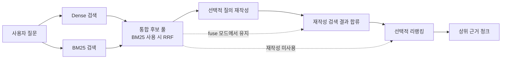
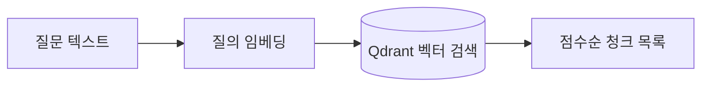
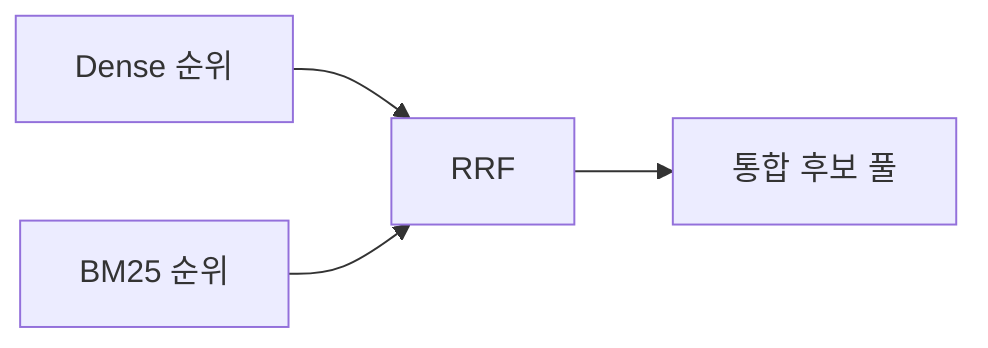
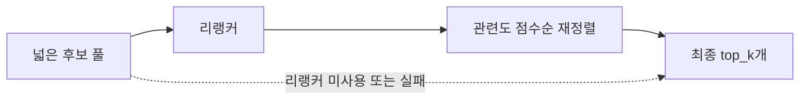
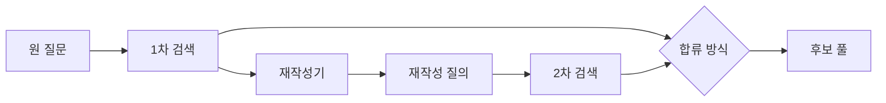

# 검색 파이프라인

이 문서는 색인된 문서 청크 가운데 질문과 가장 관련 있는 근거를 고르는 검색 파이프라인을
설명합니다. 의미 유사도를 사용하는 Dense 검색과 키워드 기반 BM25 검색을 결합하고,
필요에 따라 질의 재작성과 리랭킹으로 결과를 다듬습니다.

## 한눈에 보기



검색의 공개 진입점은 `retrieve()`입니다. 입력은 질문과 이미 열린 벡터 저장소·임베더이며,
출력은 답변 생성에 사용할 `RetrievedChunk` 목록입니다.

| 구성 요소 | 역할 | 선택 여부 |
|---|---|---|
| Dense 검색 | 질문과 청크의 임베딩 유사도로 후보 검색 | 기본 |
| BM25 | 낱말 일치와 희소 키워드 기반 후보 검색 | 선택 |
| RRF 융합 | Dense와 BM25의 순위를 하나의 목록으로 결합 | BM25 사용 시 |
| 질의 재작성 | 1차 검색 결과를 보고 검색용 질문을 다시 작성 | 선택 |
| 리랭커 | 넓은 후보 풀의 관련도 순서를 다시 계산 | 선택 |

관련 구현: [검색 공개 API](rag_pipeline/retrieval/__init__.py),
[검색 흐름](rag_pipeline/retrieval/hybrid.py)

## Dense 검색

Dense 검색은 질문을 임베딩 벡터로 바꾼 뒤, Qdrant에 저장된 청크 벡터와의 유사도를 검색합니다.
표현이 정확히 같지 않아도 의미가 비슷한 문장을 찾는 데 강점이 있습니다.



Dense 검색은 항상 먼저 실행됩니다. 색인 자체가 없거나 벡터 저장소를 열 수 없는 문제는
검색 실패로 명확히 드러나야 하기 때문입니다. 이 결과는 BM25, 재작성, 리랭킹이 꺼져 있어도
독립적으로 답변 생성에 사용할 수 있습니다.

관련 구현: [Dense 검색](rag_pipeline/retrieval/dense.py),
[벡터 저장소 검색](rag_pipeline/ingestion/indexing/qdrant_store.py)

## BM25와 하이브리드 검색

BM25는 청크 텍스트 전체에서 키워드 빈도와 희소성을 이용해 검색하는 방식입니다. 의미가
비슷한 표현을 잡는 Dense 검색과 달리, 문서에 실제로 등장하는 기관명·법령명·고유 용어에
강점을 가집니다.

한국어는 형태 단위로만 나누기 어려운 경우가 많아, 한글 연속 구간은 bigram 중심으로,
영문과 숫자는 단어 단위로 토큰화합니다.

### RRF로 순위 결합

Dense와 BM25를 함께 사용할 때는 두 점수를 직접 더하지 않고 RRF(Reciprocal Rank Fusion)로
순위를 결합합니다. 두 검색 방식의 점수 범위가 서로 달라도, 각 방식에서 높은 순위였던
청크가 안정적으로 상위에 오르게 하는 방법입니다.



BM25 인덱스는 저장소의 모든 청크를 읽어 만들어지므로, 요청마다 새로 만들지 않고 호출하는
쪽에서 한 번 만든 뒤 재사용합니다. BM25가 비어 있거나 검색 도중 실패하면 Dense 결과만으로
계속 진행하며, 경고 정보는 인덱스 객체에 남습니다.

관련 구현: [BM25](rag_pipeline/retrieval/bm25.py),
[한국어 토큰화](rag_pipeline/retrieval/tokenize.py),
[RRF 융합](rag_pipeline/retrieval/fusion.py)

## 후보 풀과 최종 결과 수

사용자에게 필요한 결과 수는 `top_k`로 정합니다. 다만 BM25, 리랭커 또는 질의 재작성을 켠
경우에는 최종 결과보다 넓은 후보 풀을 먼저 가져옵니다. 이 후보 수는 `candidate_k`와
`top_k` 중 큰 값으로 정해집니다.

```text
후보 풀(candidate_k) → 융합·재작성·리랭킹 → 최종 top_k개
```

이 구조 덕분에 리랭커는 최종 상위 5개만 다시 정렬하는 대신, 그보다 뒤에 있던 관련 청크도
상위 결과로 올릴 수 있습니다. 보조 기능을 모두 끄면 Dense 검색 결과를 바로 `top_k`만큼
반환하므로 불필요하게 넓은 후보를 처리하지 않습니다.

관련 구현: [retrieve()](rag_pipeline/retrieval/hybrid.py)

## 리랭킹

리랭커는 1차 검색 후보와 질문을 함께 보고 후보의 **순서만** 다시 매깁니다. 후보 집합을
새로 만들지는 않으므로, 검색 범위를 넓히는 Dense·BM25와는 역할이 다릅니다.

| 구현 방식 | 특징 |
|---|---|
| 로컬 Cross-Encoder | 로컬 모델로 후보별 관련도 점수 계산 |
| OpenAI LLM | 질문과 후보 목록을 LLM으로 평가 |
| Cohere API | 전용 리랭킹 API 사용 |

리랭커는 RRF 융합 뒤, 최종 `top_k`로 자르기 전에 실행됩니다. 리랭킹이 실패하거나 사용할 수
없으면 기존 후보 순서를 그대로 유지하므로, 검색 결과가 사라지지 않습니다.



관련 구현: [리랭커 팩토리](rag_pipeline/retrieval/reranker/__init__.py),
[공통 리랭킹 계약](rag_pipeline/retrieval/reranker/base.py)

## 질의 재작성

질의 재작성은 질문을 바로 바꾸지 않고, 먼저 원래 질문으로 검색한 결과를 봅니다. 그 결과에
나타난 문서 고유 용어와 질문의 일상 표현을 참고해 새 검색 질의를 만들고 한 번 더 검색합니다.
이 방식은 pseudo-relevance feedback(PRF)의 형태입니다.



두 가지 합류 방식을 지원합니다.

| 방식 | 동작 |
|---|---|
| `fuse` | 원래 질문과 재작성 질문의 검색 결과를 함께 RRF로 결합 |
| `replace` | 재작성 질문의 검색 결과만 사용 |

재작성 호출이 실패하거나 API 키가 없으면 원래 1차 검색 결과를 그대로 사용합니다. 즉 재작성은
검색을 넓히는 보조 경로이며, 사용할 수 없다고 기본 검색이 실패하지는 않습니다.

관련 구현: [질의 재작성](rag_pipeline/retrieval/rewrite.py),
[재작성 결합](rag_pipeline/retrieval/hybrid.py)

## 실측으로 본 효과와 비용

아래 수치는 PDF 문서 4종과 질의 세트로 측정한 결과입니다. 특정 데이터와 모델 조합의 결과이므로,
일반적인 보장값보다는 각 기능이 무엇을 바꾸는지 보여 주는 사례로 읽는 편이 좋습니다.

### 리랭커: 후보군이 아니라 순서를 개선

로컬 KURE-v1 + BM25 검색에서 로컬 Cross-Encoder 리랭커를 추가했을 때의 결과입니다.

| 구성 | hit@1 | nDCG@5 | MRR | hit@50 |
|---|---:|---:|---:|---:|
| KURE-v1 + BM25 | 0.4333 | 0.5718 | 0.5455 | 0.9833 |
| KURE-v1 + BM25 + 로컬 리랭커 | 0.5833 | 0.7045 | 0.6816 | 0.9833 |

상위 순위 품질은 올랐지만 `hit@50`은 변하지 않았습니다. 리랭커가 새 근거를 찾아낸 것이 아니라,
이미 후보 풀에 있던 근거를 더 앞에 배치했다는 뜻입니다. 반대로 후보 풀 자체의 상한을 높이려면
임베딩·BM25·청킹처럼 1차 검색 단계에 손을 대야 합니다.

### 로컬 리랭커: GPU가 지연을 크게 줄임

같은 로컬 Cross-Encoder와 50개 후보를 대상으로 한 측정에서 CPU는 질의당 63.862초,
CUDA는 2.988초였습니다. 약 21.4배 차이였고, 60개 질의의 순위 결과는 모두 같았습니다.

해석은 단순합니다. 로컬 리랭커의 품질을 비교할 때 CPU와 GPU를 서로 다른 검색 품질로
취급할 필요는 없었지만, CPU 지연은 대화형 화면에 그대로 쓰기 어려운 수준이었습니다.
다만 이 값은 모델이 이미 준비된 상태의 측정이며, 프로세스 첫 질의의 모델 적재 시간은
별도로 발생할 수 있습니다.

### 질의 재작성: 세트에 따라 이득의 위치가 다름

LLM 질의 세트 60건에서 RRF 검색과 `fuse` 재작성을 비교했을 때, `hit@1`은 0.4333에서
0.4500으로, `MRR@10`은 0.5455에서 0.5874로, `nDCG@10`은 0.6156에서 0.6569로 올랐습니다.
반면 사람 검수 질의 세트에서는 상위 1위·MRR 지표가 낮아진 경우도 있었습니다.

따라서 재작성은 항상 순위를 올리는 기본 기능이라기보다, 어떤 질의 세트와 사용 목표에서
이득이 있는지 별도로 평가해야 하는 선택 기능입니다.

측정 근거: [리랭커 비교](.claude/wiki/verify_log/2026-08-25-리랭커-2x2-무료칸.md),
[리랭커 GPU 측정](.claude/wiki/verify_log/2026-08-26-리랭커-GPU축.md),
[질의 재작성 측정](.claude/wiki/verify_log/2026-08-27-재작성-첫측정.md)

## 검색 결과에 담기는 정보

최종 `RetrievedChunk`에는 청크 텍스트와 출처 메타데이터 외에도 각 검색 경로의 점수가 담깁니다.
점수가 없는 경우는 0점이 아니라 해당 경로의 후보가 아니었다는 뜻으로 구분됩니다.

| 정보 | 설명 |
|---|---|
| `dense_score` | Dense 검색 점수 |
| `bm25_score` | BM25 검색 점수 |
| `rewrite_dense_score` / `rewrite_bm25_score` | 재작성 질의로 검색했을 때의 점수 |
| `fused_score` | RRF 융합 점수 |
| `rerank_score` | 리랭커가 성공했을 때의 재정렬 점수 |
| 출처 메타데이터 | 문서명, 페이지, 제목 경로, 청크 ID 등 |

관련 구현: [검색 결과 스키마](rag_pipeline/schemas/retrieval.py)

## 평가와 함께 보는 방법

검색 결과가 달라졌을 때는 지표 하나만 보지 않는 편이 좋습니다.

1. **`hit@k`, `recall@k`** — 정답 근거가 후보에 들어왔는지 확인합니다.
2. **`MRR`, `nDCG`, `precision`** — 그 근거가 사용자에게 보이는 상위 순위에 왔는지 확인합니다.
3. **질의별 순위 변화** — 평균 뒤에 숨은 특정 문서·질의의 개선과 악화를 확인합니다.
4. **경고와 사용량** — BM25·리랭커·재작성기가 실제로 실행됐는지 확인합니다.

평가 명령과 지표 정의는 [EVALUATION.md](EVALUATION.md)에 정리되어 있습니다.

## 디렉터리 안내

```text
rag_pipeline/retrieval/
├── dense.py               벡터 기반 검색
├── bm25.py                키워드 기반 검색 인덱스
├── tokenize.py            한국어·영문 토큰화
├── fusion.py              RRF 융합
├── hybrid.py              전체 검색 흐름과 후보 풀 관리
├── rewrite.py              1차 결과 기반 질의 재작성
└── reranker/
    ├── base.py            리랭커 인터페이스와 공통 처리
    ├── local_ce.py        로컬 Cross-Encoder
    ├── openai_llm.py      OpenAI LLM 리랭커
    └── cohere_api.py      Cohere 리랭커
```

## 함께 보면 좋은 문서

- [프로젝트 소개와 실행 방법](README.md)
- [전체 시스템 구성](ARCHITECTURE.md)
- [문서 적재 파이프라인](INGESTION.md)
- [검색·답변 평가 체계](EVALUATION.md)
